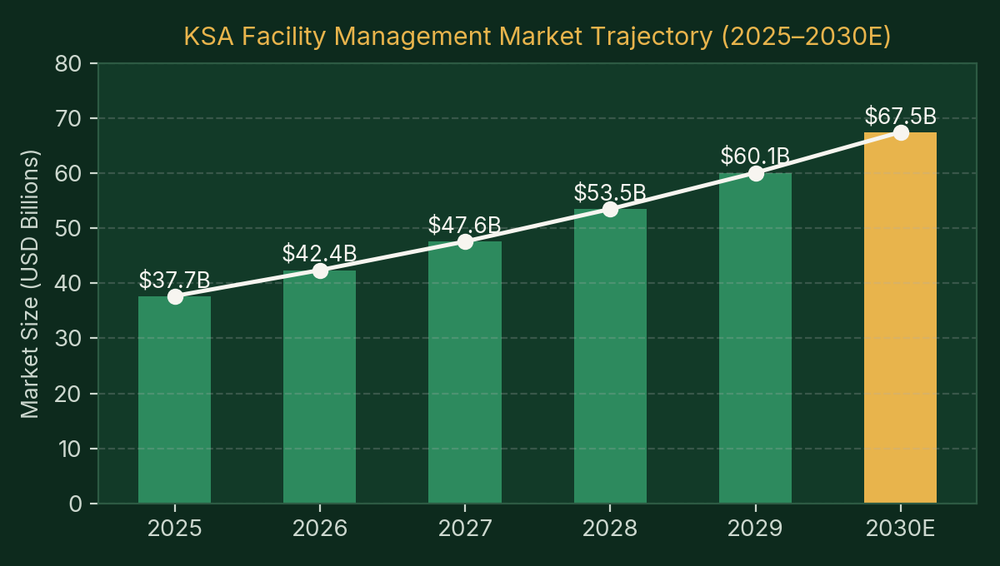
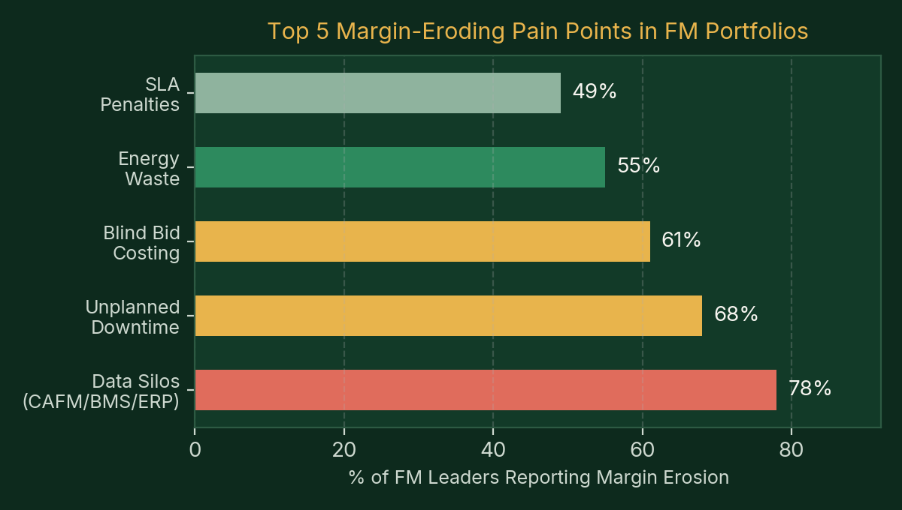
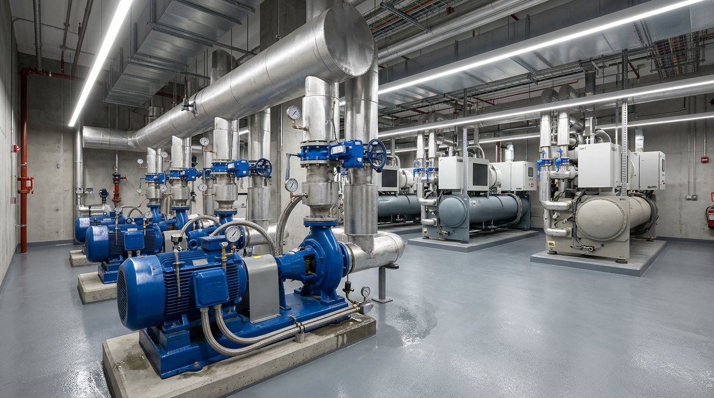
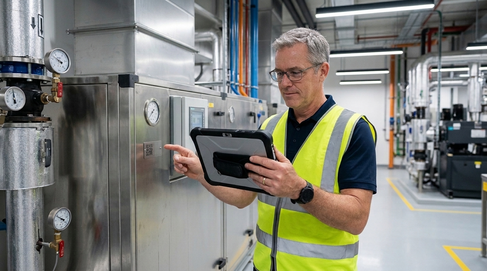
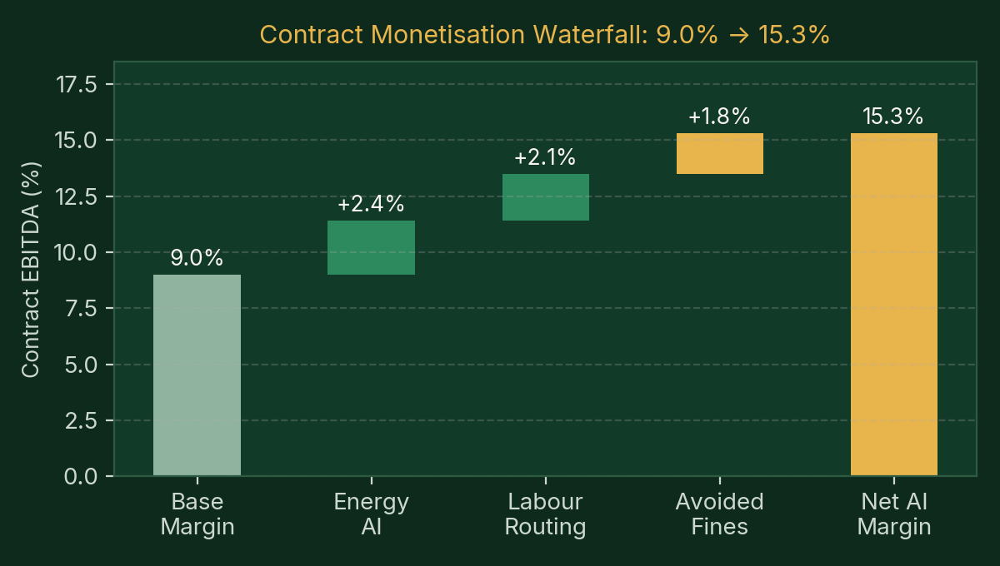
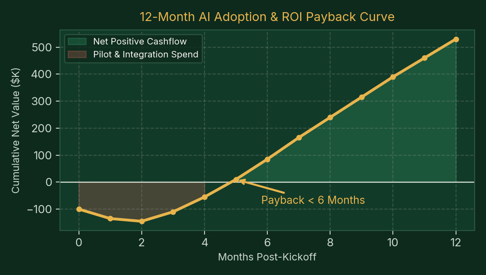
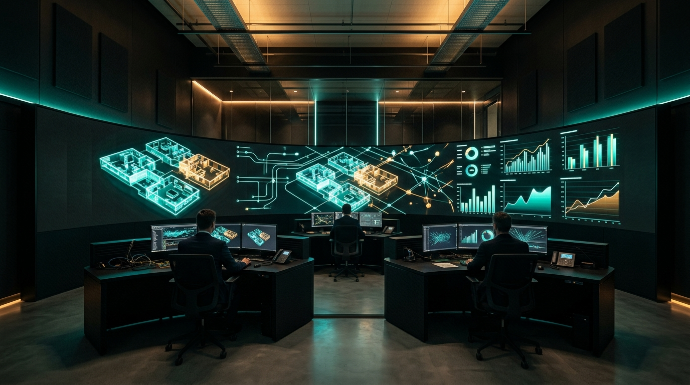
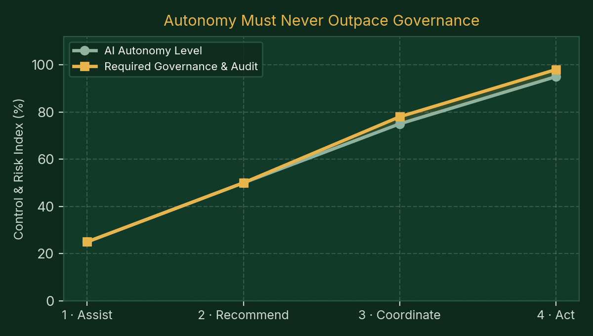

# AI Across the Facilities Management Value Chain
### From the Plant Room to the Boardroom — An IFMA-Aligned Executive Playbook for KSA & Global FM Leaders

> **Executive Thesis:** *80% of AI pilots in Facilities Management fail—not because of weak AI models, but because nobody fixed the CAFM-to-BMS-to-ERP data plumbing first.* When engineered around P&L outcomes, AI expands contract EBITDA from **9.0% to 15.3%+** and pays back in **under 6 months**.

---

## Key Industry Benchmarks

| Metric | Verified Benchmark | Commercial Impact |
| :--- | :--- | :--- |
| **KSA FM Market Trajectory** | **$37.7B → $67.5B** (2025–2030E, 12.4% CAGR) | Vision 2030 giga-projects shifting from build to 20-year IFM |
| **Unplanned Downtime** | **50% – 70% Reduction** | Eliminates emergency call-outs and SLA penalty erosion |
| **Maintenance Cost** | **10% – 40% Savings** | Dynamic scheduling replaces rigid calendar-based PPM |
| **Energy Waste** | **~30% Addressable Waste** | Continuous AI HVAC tuning cuts OpEx and hits ESG targets |
| **Net Contract EBITDA** | **9.0% → 15.3%+** | +630 bps margin expansion via energy, labour, and SLA protection |
| **Typical ROI Payback** | **< 6 Months** | Self-funding J-curve when embedded into existing CAFM/BMS |

---

## 1. Market Outlook & The C-Suite Pain Points

Under **ISO 41001** and **IFMA** frameworks, Facilities Management integrates **People, Place, and Process** to protect the core business. Yet **78% of FM leaders** report margin erosion from disconnected systems:

1. **Data Silos:** CAFM, BMS, ERP, and HR operate independently—the boardroom never sees real-time contract P&L.
2. **Blind Bidding & Mobilisation Burn:** Inaccurate RFP costing and 90-day manual asset tagging erode margins before Day One.
3. **Reactive Firefighting:** Skilled MEP technician shortages + calendar PPM drive 30% wasted energy and avoidable SLA fines.

---

## 2. Proven KSA & GCC Case Studies (Lessons & Verified ROI)

### Case Study 1: KSA Hospital Chiller Plant — `-62%` Unplanned Downtime
- **Pain Point:** Unplanned chiller trips risked OT/ICU cooling and triggered SAR 180K+ SLA penalties.
- **AI Action:** BMS telemetry + Predictive AI flagged seal wear **21 days early** at **74% confidence**.
- **Verified Result:** Downtime cut from **17.5h → 3.5h per event**, **18% energy saved**, **4.5-month payback**.
- **Lesson:** *Extend existing heavy-asset life 3–5 years without capex replacement.*

### Case Study 2: Riyadh Commercial Portfolio — `90d → 35d` Mobilisation
- **Pain Point:** Manual asset tagging caused 35% CAFM data errors and 90 days of non-billable mobilisation burn.
- **AI Action:** Technicians photographed AHU nameplates; Vision AI extracted brand, model, and O&M specs automatically.
- **Verified Result:** **100% clean CAFM in 35 days** — saving **55 days of non-billable burn** on Day One.
- **Lesson:** *Clean Day-One data prevents 5 years of blind maintenance.*

### Case Study 3: GCC Mixed-Use Portfolio — `54% → 86%` Renewal Rate
- **Pain Point:** Lost institutional memory at contract handover caused 46% contract churn.
- **AI Action:** Automated 360° value-delivered dossiers generated 6 months before contract expiry.
- **Verified Result:** **86% renewal rate** and **98% CAFM accuracy** at handover.
- **Lesson:** *The end of one contract is the commercial launchpad for the next.*

---

## 3. Commercial & EBITDA Playbook

AI is not an IT cost centre—it is a direct margin-expansion engine across **bidding (`22% → 34%` win rate)**, **energy (`-25%`)**, **labour routing**, and **avoided SLA penalties**.

---

## 4. Architecture & Governance Without Silos

Today's isolated AI point-solutions become tomorrow's expensive silos. Build one **open, modular, model-agnostic data spine** with strict **Human-in-the-Loop** accountability:

- **Assist → Recommend → Coordinate → Act:** Match governance and cybersecurity intensity to AI autonomy.
- **Zero Vendor Lock-In:** Retain 100% ownership of your operational data, models, and institutional know-how.

---

## 5. Your Next Step: The AZ Consultants KSA Funnel

> **Why AZ Consultants?** Most advisors hand you a 100-page strategy PDF and leave. As **Senior Forward Deployed Engineers**, we fix your data plumbing, pass KSA tender compliance, and prove measurable EBITDA ROI in **90 days**.

| Stage | Offer | Outcome |
| :--- | :--- | :--- |
| **1. Discover** | **Free 30-Min AI-in-FM Readiness Call** | 3 ranked use cases & quick-win assessment |
| **2. Diagnose** | **Data & Process Maturity Audit** | CAFM/BMS/ERP plumbing check + 0–5 scoring |
| **3. Design** | **Roadmap, EBITDA Model & Governance** | Prioritised portfolio with `< 6-month` payback plan |
| **4. Deliver** | **90-Day Pilot → CAFM Integration** | Working systems + KSA tender & bid support |
| **5. Scale** | **Portfolio Roll-Out & Value Tracking** | Boardroom KPIs & quarterly margin reviews |

---

### Connect & Book Stage 1 (Free)

- **Website:** [azconsultants-ksa.pages.dev](https://azconsultants-ksa.pages.dev)
- **Live Executive Report:** [azconsultants-fm-report.pages.dev](https://azconsultants-fm-report.pages.dev/)
- **27-Slide A4 Deck (PDF):** [AZ_AI_in_FM_Value_Chain_A4.pdf](https://azconsultants-fm-deck.pages.dev/AZ_AI_in_FM_Value_Chain_A4.pdf)
- **WhatsApp / Mobile:** `+966 57 426 8856` ([wa.me/966574268856](https://wa.me/966574268856))
- **Email:** `azengineeringapp@gmail.com`
- **LinkedIn:** [linkedin.com/in/aamirzameer](https://www.linkedin.com/in/aamirzameer)
- **GitHub:** [github.com/Amz34](https://github.com/Amz34)

*Engineered by **Aamir Zameer** — Senior Forward Deployed Engineer · AZ Consultants KSA.*
