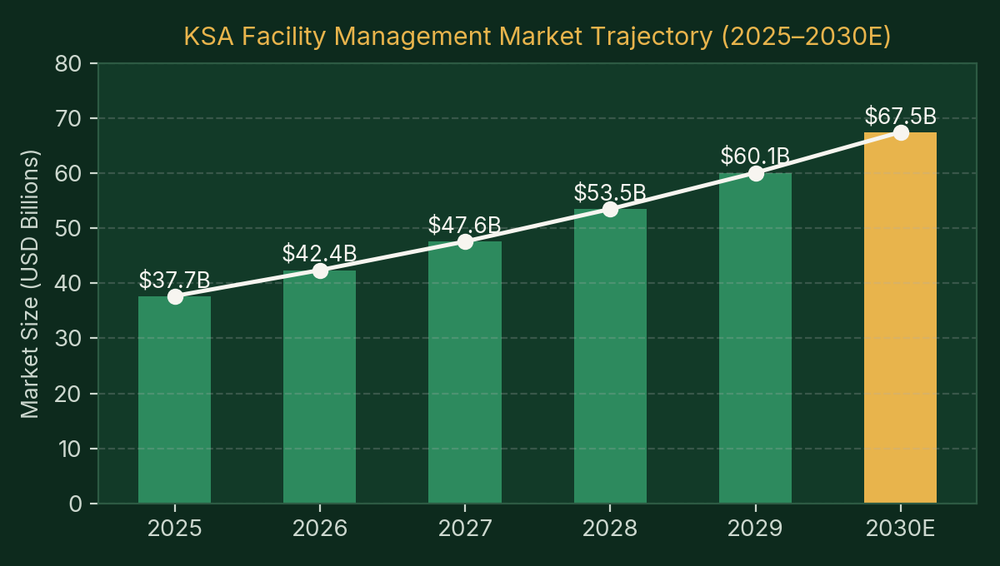
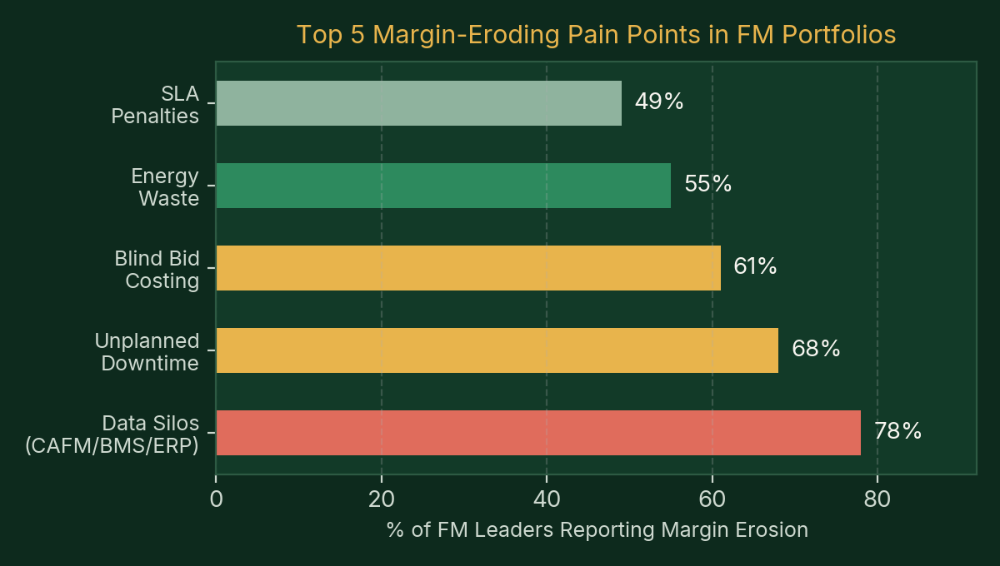

# 1. Market Outlook & C-Suite Pain Points

Under **ISO 41001** and **IFMA** frameworks, Facilities Management integrates **People, Place, and Process** to protect the core business. As Saudi Vision 2030 giga-projects transition from construction to 20-year operations, manual and reactive FM can no longer protect SLA margins.

## Why 78% of FM Leaders Lose Margin to Data Silos

1. **Disconnected Systems:** CAFM, BMS, ERP, and HR operate in silos—the boardroom never sees real-time contract P&L.
2. **Blind Bidding & Mobilisation Burn:** Inaccurate RFP costing and 90-day manual asset tagging erode margins before Day One.
3. **Reactive Firefighting:** Skilled MEP technician shortages + calendar-based PPM drive 30% wasted energy and avoidable SLA fines.

!!! tip "Commercial Leverage"
    Price contracts around **core-business uptime and occupant safety**, not headcount. Move 20% of your portfolio to outcome-based contracts within 18 months.
