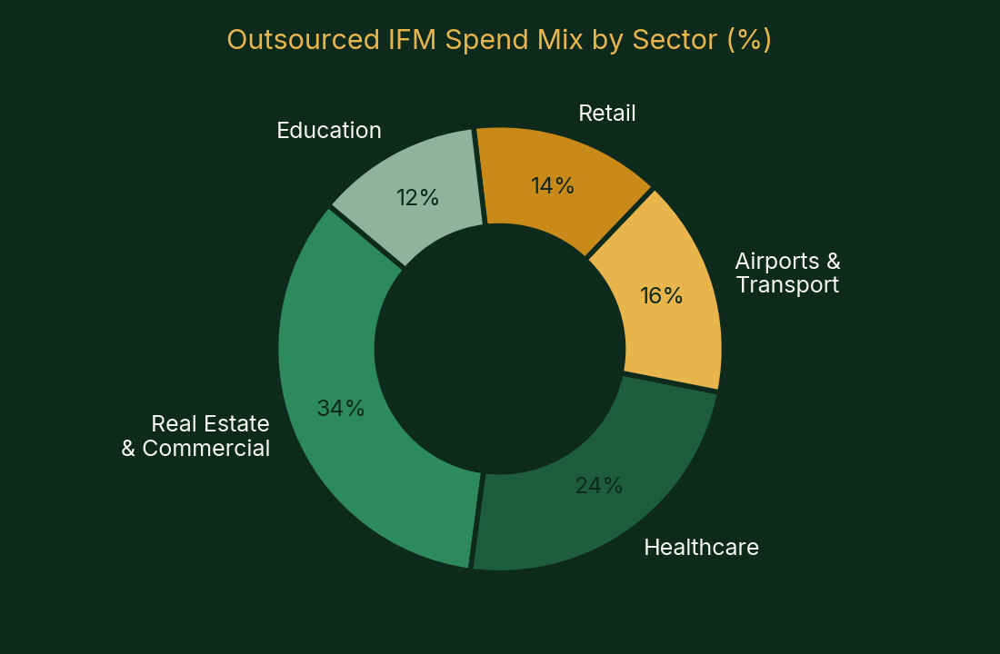
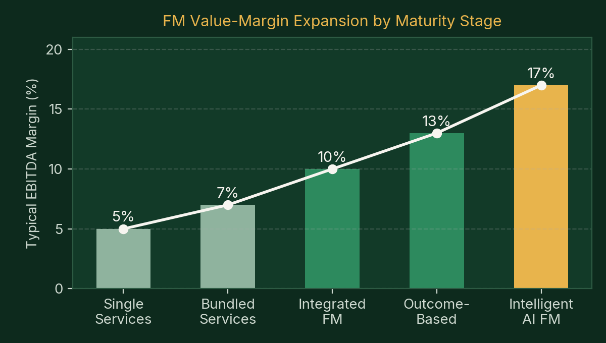

# Chapter 1: Market Outlook & C-Suite Pain Points

Under the **ISO 41001** and **International Facility Management Association (IFMA)** frameworks, Facilities Management serves a single overarching purpose: **integrating People, Place, and Process to enable the core business to thrive**. However, across global portfolios and particularly in the hyper-scaling Middle East market, disconnected legacy software, commodity bidding wars, and reactive firefighting continue to erode operational margins.

---

## 1.1 The Macroeconomic Wave: KSA Market Surges to $67.5B by 2030

The Kingdom of Saudi Arabia (KSA) is undergoing the most ambitious infrastructure and smart-city transformation in modern history. Driven by **Saudi Vision 2030**, historic giga-projects—including **NEOM, Red Sea Global, Qiddiya, Diriyah Gate, ROSHN, and New Murabba**—are transitioning from capital construction into long-term operational stewardship.

### Key Market Dynamics:
- **Market Size**: Expanding from **$37.7 Billion (2025)** to **$67.5 Billion by 2030E**.
- **Compound Annual Growth Rate (CAGR)**: Accelerating at **12.4%**, far outpacing global FM growth averages.
- **The Operational Pivot**: Asset developers are no longer asking who can build the asset; they are evaluating who can operate critical infrastructure for 20 to 30 years while meeting aggressive **ESG, Net-Zero, and occupant comfort mandates**.
- **The Plumbing Bottleneck**: Most regional portfolios still rely on a fragmented mix of paper logs, isolated spreadsheets, disconnected legacy CAFM software, and proprietary BMS systems. Without unifying this data spine, advanced AI cannot scale.

---

## 1.2 The Root Cause: Why 78% of FM Leaders Lose Margin to Data Silos

Industry surveys conducted across IFMA members and enterprise FM operators reveal that **78% of FM leaders suffer chronic EBITDA compression caused by data fragmentation**.

### The 5 Structural Margin Killers:

1. **The 80% Pilot Failure Trap:**  
   80% of enterprise AI pilots in FM stall or fail. The failure is virtually never the underlying AI algorithm; it occurs because the basic **CAFM-to-BMS-to-ERP integration plumbing was never architected**. Without clean, normalized operational telemetry, algorithms ingest garbage data and output untrusted recommendations.

2. **Commodity Price Wars (5% – 7% EBITDA Trap):**  
   Operators trapped in traditional single-service input-based tenders (manpower supply, cleaning rotas, scheduled MEP visits) are commoditized into cut-throat margin wars. Without demonstrable technology differentiation, clients award bids strictly on the lowest hourly labour rate.

3. **Blind Bidding & Mobilisation Cost Overruns:**  
   FM providers bid on ambiguous RFP asset registers. Upon contract award, manual asset tagging teams spend 90+ days uncovering unmaintained machinery, burning unbilled cash before service delivery even commences.

4. **Reactive Firefighting & Unplanned Downtime:**  
   Critical HVAC, chillers, and pumps are run to failure or maintained on static calendar schedules. Catastrophic mid-summer equipment breakdowns trigger emergency specialist call-out fees, tenant dissatisfaction, and severe contractual SLA penalties.

5. **Contract Handover Knowledge Amnesia:**  
   When a 3-year or 5-year contract approaches renewal, the institutional memory lives in the heads of outgoing technicians and scattered job cards. Service providers fail to articulate value delivered, losing renewals or giving away pricing concessions.

> [!IMPORTANT]
> **Authority & Monetisation Rule:**  
> *Fix your operational data plumbing first. Converting fragmented silos into an integrated operational data spine is the prerequisite that elevates contract EBITDA from 5% to 15%–17%+.*

---

## 1.3 One FM Discipline, Five Distinct Sector Economics

While core FM principles remain consistent, **commercial value is defined differently across operating sectors**. High-performing FM leaders align their technological SLAs with their client’s sector-specific P&L drivers:

| Sector | Outsourced Spend Share | Critical Asset Focus | Primary P&L Driver / True Metric of Value |
| :--- | :--- | :--- | :--- |
| **Commercial Real Estate & Retail** | **48%** | Elevators, central HVAC, facade, lighting | **Footfall index, tenant lease renewal rate, net asset valuation** |
| **Healthcare & Life Sciences** | **24%** | Operating theatre chillers, med-gas, cleanrooms | **Bed availability, zero infection risk, zero-tolerance patient safety** |
| **Aviation & Transportation** | **16%** | Baggage handling, jet-bridges, runway lighting | **Gate turnaround velocity, zero passenger journey disruption** |
| **Education & Universities** | **8%** | Campus energy, lab ventilation, smart access | **Learning environment availability, seasonal energy curtailment** |
| **Critical Infrastructure & Data Centers** | **4%** | Power redundancy (UPS, generators), precision cooling | **100% uptime SLA (Five Nines), PUE energy optimization** |

> [!TIP]
> **Executive Alignment Tip:**  
> Never talk to a Hospital CEO about "number of work orders completed." Speak their P&L language: *"Our predictive HVAC intelligence guaranteed 99.98% OT bed availability and prevented SAR 180,000 in regulatory disruption fines."*

---

## 1.4 The 30-Year Evolution: Tripling EBITDA Through Maturity

Over the past three decades, Facilities Management has evolved across five maturity tiers. Operators who fail to climb this curve will face inevitable margin extinction:

1. **Stage 1 & 2: Single & Bundled Services (5% – 7% EBITDA)**  
   - Model: Input-based commodity labor (cleaners, security guards, MEP technicians).  
   - Commercial reality: Zero differentiation; client dictates margins; fierce price undercutting.
2. **Stage 3: Integrated Facilities Management (IFM) (10% – 12% EBITDA)**  
   - Model: Unified multi-service delivery under a centralized management team with basic CAFM tracking.  
   - Commercial reality: SLA-driven contracts with modest efficiency gains through bundled overheads.
3. **Stage 4: Outcome-Based Contracting (12% – 14% EBITDA)**  
   - Model: Risk-and-reward sharing tied directly to asset uptime, energy reductions, and customer satisfaction scores.
4. **Stage 5: Intelligent AI-Orchestrated FM (17%+ EBITDA)**  
   - Model: Predictive telemetry, automated agentic dispatch, computer vision surveillance, and autonomous energy optimization.  
   - Commercial reality: Decoupling revenue from headcount. Contracts achieve superior service levels with optimized staffing, generating record EBITDA margins.

---

### Key Takeaways for FM Leadership

- **Shift 20% of your portfolio** to outcome-based and technology-underwritten contracts within the next 18 months.
- **Audit your foundational data plumbing** before procuring any standalone AI tools.
- **Define value by client outcomes**, not technician hours logged on a timesheet.

👉 **Next Step:** [Chapter 2: The AI Toolbox for FM — Deconstructing the 6 Core Technologies](02-ai-toolbox.md)
