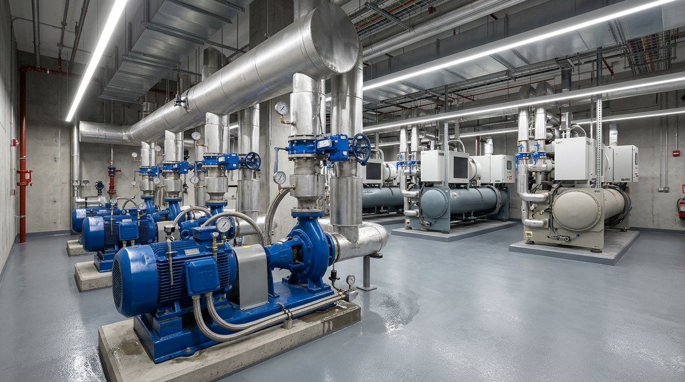
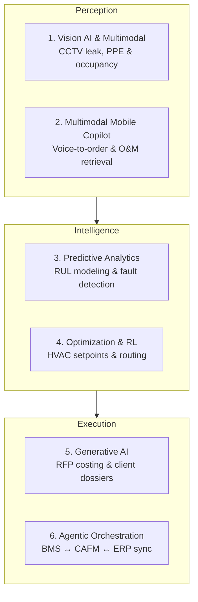
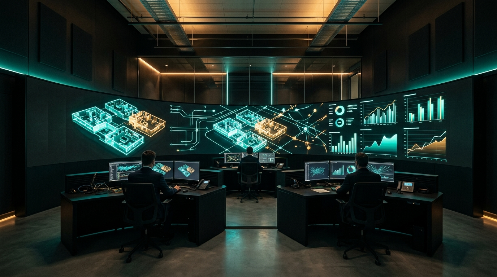
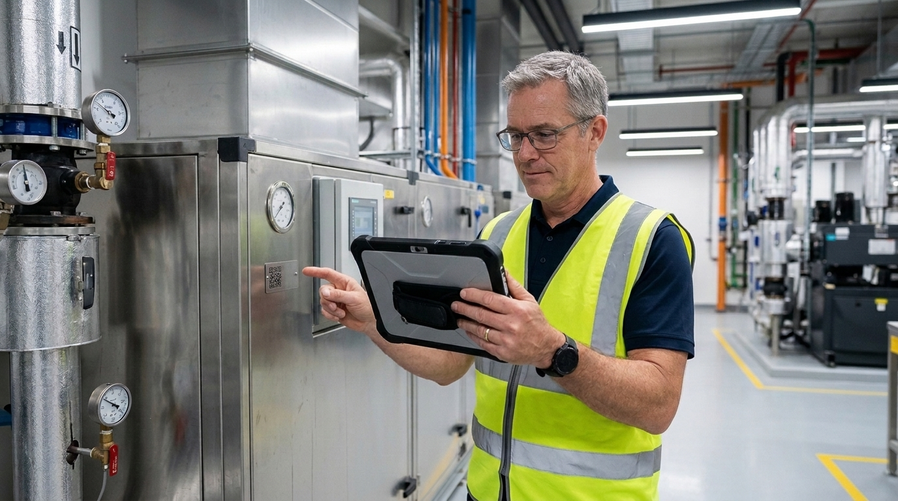

# Chapter 2: The AI Toolbox for Facilities Management

AI in Facilities Management is not a monolithic product or a generic chatbot; it is an integrated toolbox of **six specialized algorithmic capabilities**. When orchestrated together, they transform static physical infrastructure into an intelligent, self-monitoring, and revenue-accretive operational asset.



---

## 2.1 The Industry-Verified AI Impact Ceilings

Independent global benchmarks across millions of square meters of commercial, healthcare, and industrial portfolios confirm substantial operational improvements when combining multiple AI disciplines:


- **Unplanned Equipment Downtime**: Reduced by **50% to 70%** via vibration, thermal, and electrical telemetry forecasting.
- **Preventive Maintenance Labor Cost**: Reduced by **10% to 40%** by replacing rigid calendar cycles with true condition-based triggers.
- **Commercial Energy Consumption**: Curtailed by **15% to 30%** through autonomous chiller plant and AHU optimization.
- **Helpdesk & Dispatch Overhead**: Lowered by **30%** via agentic automated triaging.

---

## 2.2 The 6 Specialized AI Capabilities



---

### 1. Vision AI: Turning Existing CCTV into a 24/7 Digital Sentinel

Traditional facility camera systems are passive security recording devices that only get reviewed *after* an incident occurs. **Vision AI converts existing IP cameras and CCTV feeds into active, real-time diagnostic sensors** without installing new wiring or intrusive sensors.

```text
[ Physical World ]
       │
       ▼  CCTV Camera Stream (RTSP / ONVIF)
[ Vision AI Model ] ──► Detects abnormal water pooling near Chilled Water Pump P-03
       │
       ▼  Contextual Geometry Engine
[ Context Engine ] ──► Correlates asset ID, confirms no personnel present, flags rising severity
       │
       ▼  Automated Action
[ Actionable Alert ] ─► Generates CAFM work order: "Chilled water leak detected at P-03 mechanical seal"
```

- **Mechanical Leak Detection**: Identifies subtle water accumulation, oil pooling, and refrigerant line condensation in unstaffed plant rooms.
- **HSEQ & Safety Compliance**: Continuously flags missing personal protective equipment (PPE)—hard hats, high-vis vests, safety goggles—in mechanical basements and high-voltage switchgear rooms.
- **Space & Occupancy Optimization**: Measures real-time footfall, desk utilization, and queue density to trigger dynamic on-demand cleaning rather than scheduled sweeps.

> [!TIP]
> **Monetisation & Authority Tip:**  
> Do not spend capital on thousands of new standalone IoT sensors. Leverage your client's existing security CCTV infrastructure by overlaying lightweight Vision AI edge inference models.

---

### 2. Agentic AI: Autonomous Cross-System Orchestration

The ultimate operational bottleneck in modern FM is human triage latency. A BMS detects a temperature threshold breach; a human operator must notice the alarm, open the CAFM software, manually draft a work order, verify parts availability in SAP/Oracle ERP, and call a technician.



**Agentic AI acts as an autonomous operational conductor**, operating seamlessly across legacy system boundaries:

1. **Cross-System Synchronization**: Continuously reads telemetry from BMS/SCADA, validates asset status against CAFM history, and verifies spare parts inventory in ERP.
2. **Coordinated Multi-Service Dispatch**: When a pump seal fails, the agentic engine automatically:
   - Isolates the pump sequence via BMS logic.
   - Dispatches a certified mechanical technician with the exact replacement seal model and torque specifications.
   - Dispatches a cleaning team to remediate pooled water before it breaches electrical conduits.
3. **Human-in-the-Loop Safeguards**: High-risk actions (HVAC total shutdowns, fire suppression overrides, high-value procurement) automatically halt and require supervisor tap-to-approve confirmation on a mobile terminal.

---

### 3. Predictive Machine Learning: Remaining Useful Life (RUL)

Predictive models ingest high-frequency sensor telemetry—compressor discharge temperatures, motor vibration spectra, motor stator current, and differential pressure—to forecast mechanical degradation:

$$\text{RUL} = f(\text{Vibration Amplitude}, \Delta T_{\text{lift}}, \Delta P_{\text{refrigerant}}, \text{Runtime Hours})$$

- Shifts maintenance from **reactive firefighting** (repairing after catastrophic breakdown) and **inflexible preventive PPM** (servicing machines that do not need it) to **prescriptive maintenance** (servicing assets exactly when required before performance degrades).
- Generates 15- to 30-day early failure warnings, converting high-stress emergency repairs into orderly, scheduled off-peak overhauls.

---

### 4. Multimodal Mobile Copilots: Empowering Field Technicians

Frontline technicians often waste up to 40% of their billable shift traveling back to the site office, searching through dusty paper O&M manuals, and typing tedious work order summaries on cramped mobile keyboards.



- **Voice-to-Work-Order Logging**: Technicians speak natural language audio notes in English, Arabic, or Hindi. The multimodal copilot transcribes, extracts technical parameters, structures the summary, and closes the CAFM job card automatically.
- **Instant Engineering Knowledge Retrieval**: The technician points their tablet camera at an AHU nameplate or complex electrical relay; the copilot instantly pulls exact wiring schematics, torque tolerances, and diagnostic fault trees from digitized technical libraries.
- **First-Time Fix Acceleration**: Ensures the technician arrives at the plant room with the correct gaskets, tools, and calibration equipment on trip one, lifting first-time fix rates by **over 20%**.

---

### 5. Reinforcement Learning: Continuous Energy Optimization

Heating, ventilation, and air conditioning (HVAC) systems account for **up to 60% of total electrical energy spend in Middle Eastern commercial buildings**. Static BMS setpoints cannot adapt to rapid changes in ambient wet-bulb temperature, building thermal inertia, and dynamic occupant density.

- **Dynamic Setpoint Modulation**: Autonomous algorithms continuously modulate chilled-water supply temperatures, condenser water loops, and variable frequency drive (VFD) speeds every 5 minutes.
- **Peak Shaving**: Pre-cools building thermal mass during off-peak utility tariffs, cutting peak electrical demand charges without compromising tenant comfort.

---

### 6. Generative AI: Precision RFP Costing & Bidding Automation

Pre-contract commercial leverage dictates the entire profitability lifecycle of a 5-year FM contract. Generative AI tools ingest massive tender documentation to automate:

- **RFP Ingestion & Scope Parsing**: Extracts technical SLA penalties, required staffing ratios, and asset registers across thousands of pages of tender documents in minutes.
- **Compliance Matrix Generation**: Eliminates human oversight errors by cross-checking proposal drafts against mandatory client qualification clauses.
- **Speed to Proposal**: Accelerates bid turnaround velocity by **65%**, enabling bid teams to submit higher-quality bids with validated margin models.

---

### Key Takeaways for FM Leadership

- AI is not an all-or-nothing proposition; deploy the specific AI tool that maps directly to your largest P&L cost center.
- Always implement strict **Human-in-the-Loop** approval gates for safety-critical and financial execution triggers.
- Equip your frontline workforce with voice and vision tools; when you solve data collection for the technician, you solve reporting for the board.

👉 **Next Step:** [Chapter 3: KSA & GCC Case Studies — Real-World Performance Audits](03-ksa-case-studies.md)
