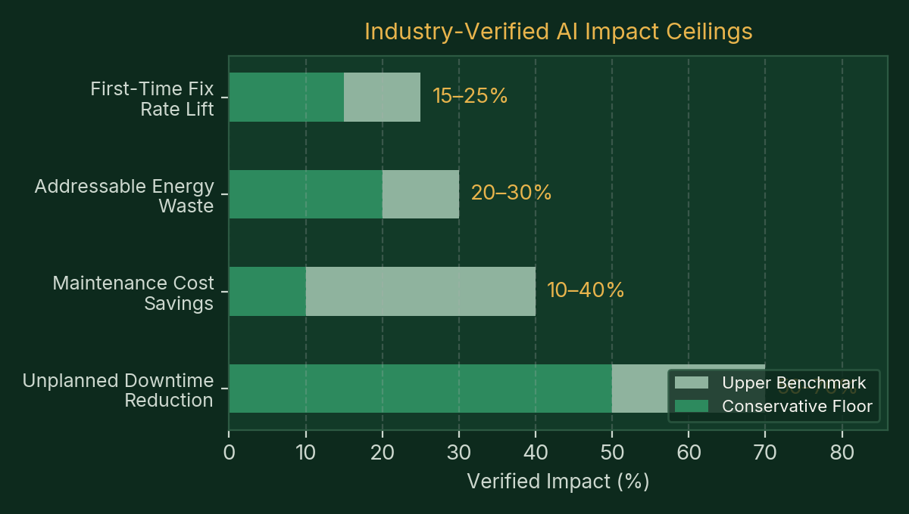

# 2. The AI Toolbox for FM

AI is not one technology—it is a toolbox of **six specialised intelligences** that solve different FM problems when combined around a business outcome.

## From Vision AI to Agentic Orchestration

- **Vision & Multimodal AI:** Turns existing security CCTV into a 24/7 leak, safety, and occupancy sensor—zero new wiring.
- **Generative & Contextual AI:** Reads RFPs, generates compliant bid drafts, and translates raw alerts into plain-language diagnoses.
- **Predictive & Optimisation AI:** Forecasts chiller/pump failures 15–30 days early and tunes HVAC schedules to cut 20–30% energy waste.
- **Agentic AI:** Coordinates BMS, CAFM, ERP, and field technicians with **Human-in-the-Loop** approval gates.

