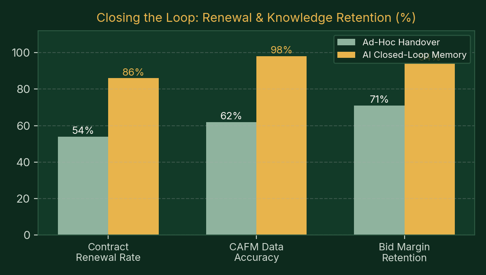

# 3. Proven KSA & GCC Case Studies

Real operational transformations across healthcare, commercial portfolios, and contract renewals.

## Case Study 1: KSA Hospital Chiller Plant (`-62%` Downtime)

- **Pain Point:** Unplanned chiller trips risked OT/ICU cooling and triggered SAR 180K+ SLA penalties.
- **AI Action:** BMS telemetry + Predictive AI flagged seal wear **21 days early** at **74% confidence**.
- **Verified Result:** Downtime cut from **17.5h → 3.5h per event**, **18% energy saved**, **4.5-month payback**.
- **Lesson:** *Extend existing heavy-asset life 3–5 years without capex replacement.*

## Case Study 2: Riyadh Commercial Portfolio (`90d → 35d` Mobilisation)

- **Pain Point:** Manual asset tagging caused 35% CAFM data errors and 90 days of non-billable mobilisation burn.
- **AI Action:** Technicians photographed AHU nameplates; Vision AI extracted brand, model, and O&M specs automatically.
- **Verified Result:** **100% clean CAFM in 35 days** — saving **55 days of non-billable burn** on Day One.
- **Lesson:** *Clean Day-One data prevents 5 years of blind maintenance.*

## Case Study 3: GCC Mixed-Use Portfolio (`54% → 86%` Renewal Rate)

- **Pain Point:** Lost institutional memory at contract handover caused 46% contract churn.
- **AI Action:** Automated 360° value-delivered dossiers generated 6 months before contract expiry.
- **Verified Result:** **86% renewal rate** and **98% CAFM accuracy** at handover.
- **Lesson:** *The end of one contract is the commercial launchpad for the next.*

