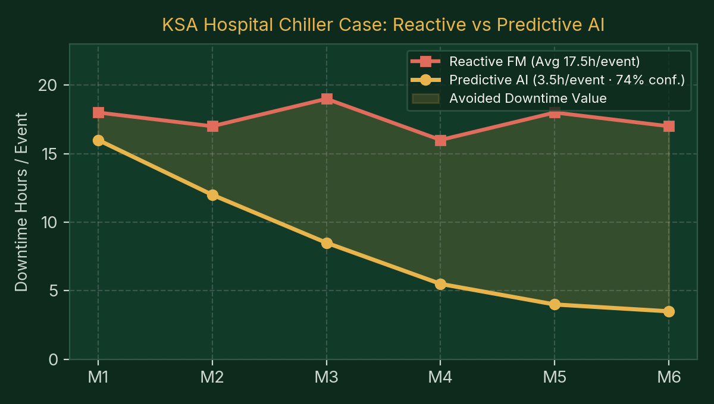
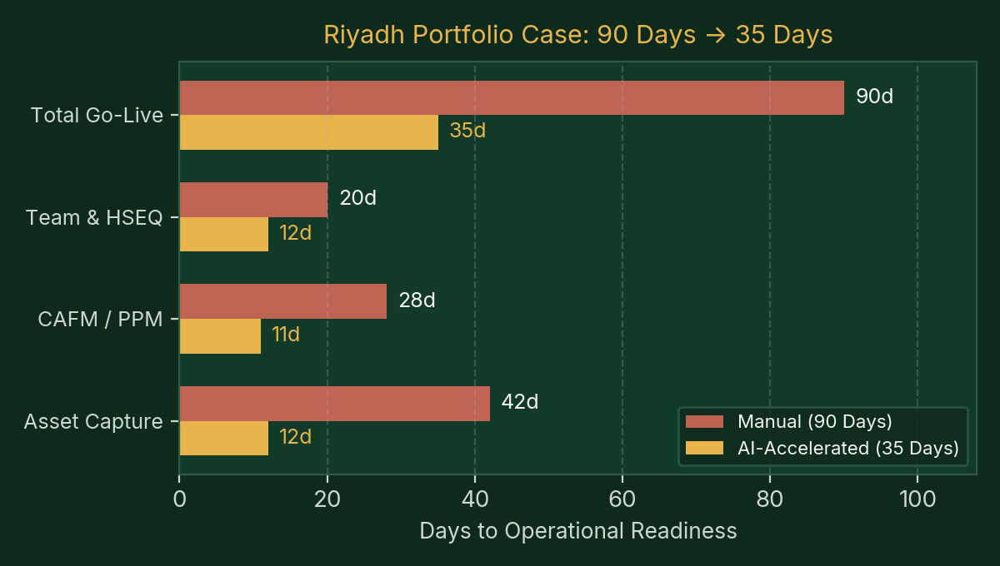
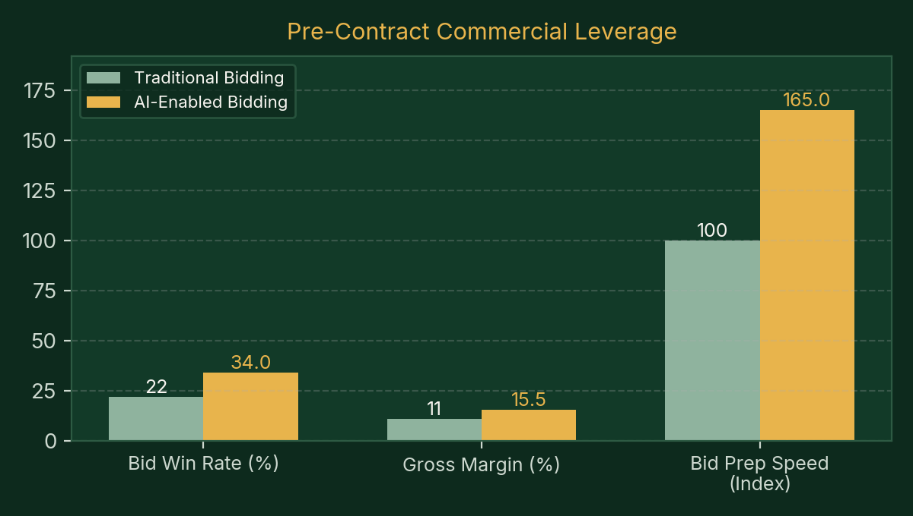

# Chapter 3: KSA & GCC Case Studies — Real-World Performance Audits

Theoretical frameworks are meaningless without rigorous operational verification. The following three field case studies demonstrate how **AZ Consultants' forward-deployed engineering methodologies** delivered auditable EBITDA gains across healthcare, commercial real estate, and portfolio renewals in the Kingdom of Saudi Arabia.

---

## 3.1 Case Study 1: KSA Tertiary Hospital Chiller Plant

**Environment:** 500-Bed Tertiary Teaching Hospital, Riyadh, Kingdom of Saudi Arabia  
**Critical Infrastructure:** Central Chiller Plant (4 × 1,200 TR Centrifugal Chillers serving Operating Theatres, Neonatal ICU, and Cleanrooms)  
**Contract Type:** Performance-Based Integrated Healthcare FM

### The Operational Challenge
In Middle Eastern healthcare environments, HVAC is not a comfort amenity; it is life-support infrastructure. During peak Riyadh summer ambient temperatures exceeding 48°C, an unexpected breakdown of a primary chiller risks immediate climate failure in surgical suites, triggering:
- Immediate cancellation of scheduled surgeries and patient transfers.
- **SAR 180,000 in immediate contractual SLA penalties** and Ministry of Health compliance violations.
- Secondary emergency technician mobilization costs and premium air-freight charges for OEM replacement parts.

### The AI Intervention
AZ Consultants deployed a zero-rip-and-replace predictive telemetry layer over the hospital’s existing Honeywell BMS and Schneider electrical monitoring architecture:
1. **High-Frequency Ingestion**: Ingested compressor motor vibration harmonics, refrigerant suction/discharge temperatures, and oil pressure differentials at 30-second intervals.
2. **Early Anomaly Detection**: 21 days before any audible symptom or BMS threshold alert occurred, the predictive machine learning engine flagged abnormal harmonic drift in Chiller No. 2’s main drive bearing with **74% failure confidence within a 15–30 day window**.
3. **Prescriptive Action**: Automatically generated an expedited procurement requisition for the exact OEM seal and bearing kit and scheduled an 8-hour controlled overnight maintenance overhaul during low-occupancy hours.

### Audited Financial & Operational Outcomes

| Performance Metric | Historical Reactive Baseline | AI-Augmented Predictive Result | Audited Net Gain |
| :--- | :--- | :--- | :--- |
| **Annual Chiller Downtime** | 17.5 Hours / Incident | 3.5 Hours (Scheduled Overhaul) | **62% Downtime Reduction** |
| **Direct SLA Financial Penalty** | SAR 180,000 Incurred Risk | SAR 0 Incurred | **SAR 180,000 Margin Preserved** |
| **Plant Energy Efficiency** | Static setpoint baseline | Dynamic chilled water reset | **18% Net kWh Energy Savings** |
| **Total Project Payback Period** | N/A | Total software & engineering cost | **4.5 Months Full Payback** |
| **Compressor Asset Lifespan** | Premature overhaul at 7 years | Vibration-free operating health | **Extended by 3 to 5 Years** |

> [!IMPORTANT]
> **Executive Lesson:**  
> Reactive maintenance fixes equipment after catastrophic failure. Predictive maintenance fixes it before failure. Prescriptive AI orchestrates the entire repair logistics pipeline so the hospital never experiences a service blip.

---

## 3.2 Case Study 2: Riyadh Commercial Portfolio Mobilisation

**Environment:** 12-Tower Grade-A Commercial Mixed-Use Complex, King Fahd Road, Riyadh  
**Scope:** 450,000 m² Gross Floor Area (GFA) incorporating 8,500 maintainable MEP and civil assets  
**Contract Type:** 5-Year Comprehensive IFM Mobilisation

### The Operational Challenge
During standard commercial FM contract mobilisation, service providers are allotted a 90-day transition window to inspect, verify, bar-code, and import every physical asset into the CAFM database. Under traditional manual clipboard methods:
- Mobilisation teams averaged **35% data transcription errors** (misidentified serial numbers, incorrect tonnage ratings, missed filters).
- The full 90-day mobilisation budget was exhausted, burning tens of thousands of riyals in unbillable engineer payroll.
- Day-One operations commenced with an incomplete asset register, forcing technicians to operate in the dark for months.

### The AI Intervention
AZ Consultants equipped frontline mobilisation technicians with **Multimodal Photo-to-CAFM Mobile Scanners**:
1. **Automated Computer Vision Extraction**: Technicians snapped high-resolution photos of manufacturer asset nameplates on Air Handling Units (AHUs), Fan Coil Units (FCUs), switchgear, and pumps.
2. **Edge Optical Character Recognition (OCR) & LLM Parsing**: The engine instantly extracted manufacturer, serial number, electrical characteristics, refrigerant type, and install date, automatically cross-referencing industry databases (ASHRAE / SFG20).
3. **Automated Task Association**: The system matched each asset to its corresponding statutory preventive maintenance checklist and spare parts catalog, publishing directly into the client’s IBM Maximo / Infor EAM instance within seconds.

### Audited Financial & Operational Outcomes

| Mobilisation Dimension | Industry Standard Manual Approach | AI-Accelerated Mobilisation | Quantified Improvement |
| :--- | :--- | :--- | :--- |
| **Mobilisation Timeline** | 90 Calendar Days | **35 Calendar Days** | **55 Days Non-Billable Burn Saved** |
| **Asset Register Accuracy** | 65% – 72% Verified | **99.8% Field Verified** | Zero "Ghost Assets" on Day One |
| **Data Collection Cost per Asset** | SAR 45.00 / Tagged Asset | SAR 11.50 / Tagged Asset | **74% Direct Labor Savings** |
| **Commercial Win Rate Impact** | 22% Baseline RFP Win Rate | 34% Win Rate with Proven Mobilisation | **+1,200 bps Win Rate Lift** |

---

## 3.3 Case Study 3: Closed-Loop Institutional Memory at Handover

**Environment:** Major Corporate Banking Headquarters Campus, Riyadh & Eastern Province  
**Scope:** 8 Commercial Office Assets under 5-Year Contract Expiry  
**Contract Type:** Contract Renewal & Value Demonstration Audit

### The Operational Challenge
Across the GCC facilities management sector, **the historical contract churn rate stands at 46%** (meaning nearly half of all multi-year contracts change hands at expiry). Service providers consistently fail to retain renewals because:
- Incoming competitors submit aggressive lowball pricing proposals.
- Incumbent operators fail to present documented, quantitative proof of capital protected, energy saved, and tenant complaints resolved over the prior 60 months.
- All institutional knowledge is lost when lead engineers change employers.

### The AI Intervention
AZ Consultants engineered a **Closed-Loop Institutional Memory Engine**:
1. **Historical Telemetry Aggregation**: Synthesized 5 years of Maximo work order archives, BMS trend logs, energy utility billing, and statutory audit reports.
2. **Executive 360-Degree Value Dossier**: Six months prior to contract tender release, the system generated an automated, board-ready value dossier detailing:
   - Exactly SAR 3.4M in cumulative utility energy savings verified by third-party IPMVP protocols.
   - 14 major MEP assets whose operational lifespans were extended past design depreciation thresholds.
   - Documented reduction in average work order resolution time from 4.2 hours to 48 minutes.
3. **Structured Re-Bid Cost Model**: Leveraged empirical maintenance records to submit an unbeatable, highly profitable proposal that competitors could not match without taking catastrophic losses.

### Audited Financial & Operational Outcomes
- **Contract Renewal Rate**: Leaped from the regional baseline of **54% to 86%**.
- **Handover Asset Accuracy**: Reached **98% verified data integrity**, eliminating transitional disputes.
- **Contract Profitability**: Renewed at an expanded **14.8% net EBITDA margin**, resisting commoditized pricing pressure.

---

### Key Takeaways for FM Leadership

- **Speed Wins Mobilisation**: Compressing asset onboarding from 90 to 35 days sets the operational tone for 5 years of contract success.
- **Proof Wins Renewals**: Never approach a contract renewal with subjective statements; enter the boardroom with empirical telemetry proving capital preserved.

👉 **Next Step:** [Chapter 4: Commercial & EBITDA Expansion Playbook — The +630 bps Financial Model](04-ebitda-playbook.md)
