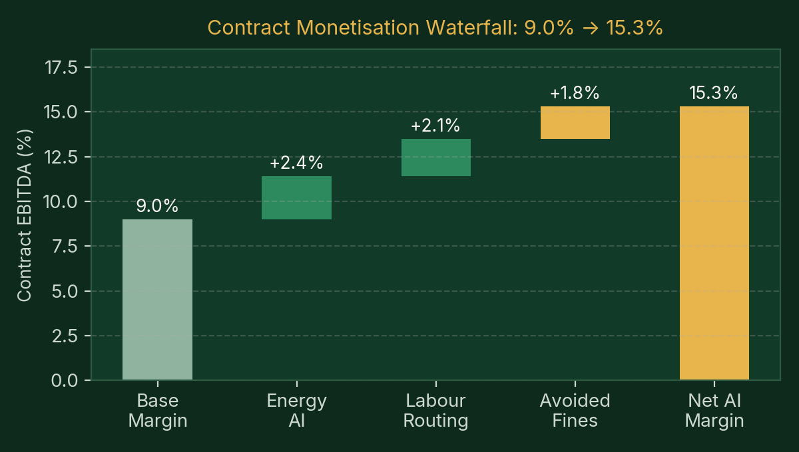

# 4. Commercial & EBITDA Playbook

AI is not an IT cost centre—it is a direct margin-expansion engine across **pre-contract bidding**, **energy**, **labour routing**, and **avoided SLA penalties**.

## Expanding Net Contract EBITDA: `9.0% → 15.3%`

1. **Energy AI (+2.4%):** 30% addressable commercial energy waste cut via continuous HVAC tuning.
2. **Dynamic Labour Routing (+2.1%):** Eliminates idle travel and overtime across hard, soft, and specialised services.
3. **Avoided SLA Penalties (+1.8%):** Proactive failure prevention preserves performance bonus pools.

!!! success "Commercial Leverage Tip"
    Structure **shared-savings clauses** with asset owners to split the 20–30% AI energy reduction 50/50, turning sustainability into pure profit.
