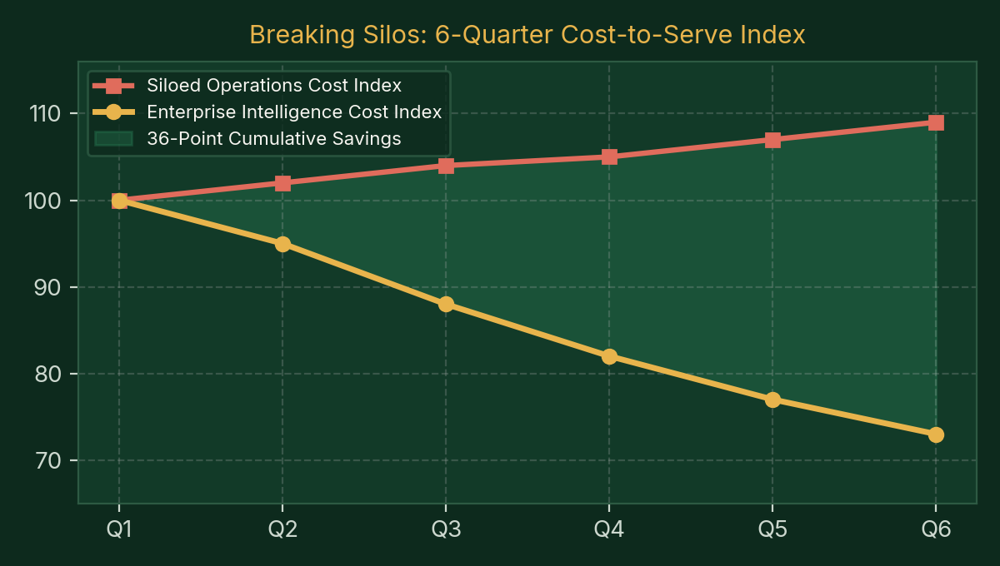
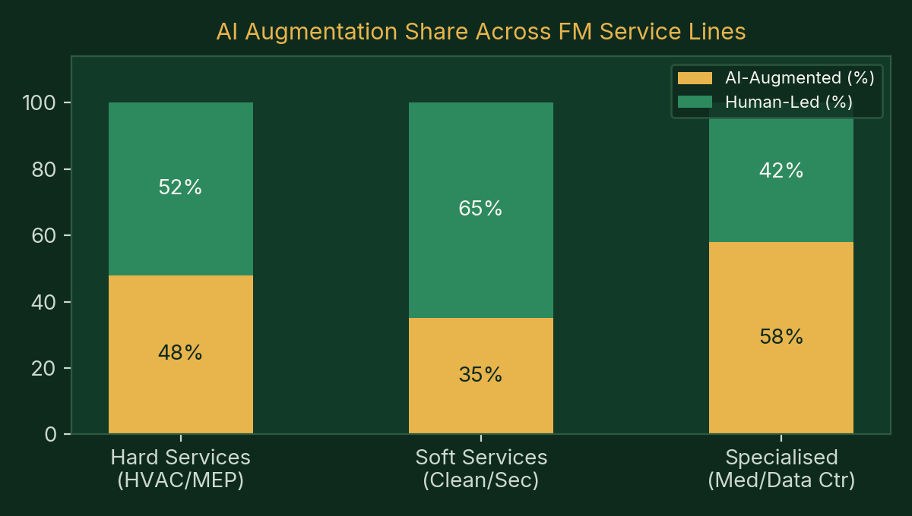

# Chapter 4: Commercial & EBITDA Expansion Playbook

In the facilities management boardroom, technology is only as valuable as its contribution to the bottom line. Traditional single-service FM operations operate on razor-thin operating margins of 5% to 7%, leaving zero cushion for unexpected cost inflation, labor turnover, or contractual penalties.

This chapter presents the **financial engineering playbook developed by AZ Consultants**, demonstrating how intelligent, data-driven contract orchestration systematically expands net contract EBITDA from **9.0% to 15.3%+ (+630 bps)**.

---

## 4.1 The +630 bps EBITDA Margin Waterfall

Contract EBITDA does not expand through arbitrary price increases; it expands by systematically recapturing waste embedded within traditional maintenance workflows:


$$\text{Net Contract EBITDA} = \text{Baseline (9.0\%)} + \Delta_{\text{Energy}} (2.4\%) + \Delta_{\text{Labour}} (2.1\%) + \Delta_{\text{SLA}} (1.8\%) = \mathbf{15.3\%}$$

### The Three High-Yield Levers:

### 1. Energy AI Optimization (+2.4% Net EBITDA Lift)
- **The Waste Pool**: Across commercial, hospitality, and healthcare assets in the Gulf, heating, ventilation, and cooling systems waste approximately **30% of total electrical energy** due to simultaneous heating/cooling, static chilled-water setpoints, and off-hours ventilation over-supply.
- **The Intervention**: Automated algorithms continuously modulate chilled-water supply temperatures, cooling tower fan stages, and air-handler static pressure based on real-time external weather forecasts and occupancy trends.
- **Contract Monetisation Mechanism**: Service providers transition away from fixed-fee utilities into **50/50 Shared Energy Savings Performance Clauses**. The client lowers their utility bills by 15% to 25%; the FM provider receives 50% of the auditable net savings as pure profit, adding +240 bps directly to contract EBITDA.

### 2. Dynamic Labour Routing & Productivity (+2.1% Net EBITDA Lift)
- **The Waste Pool**: Frontline technicians spend up to 35% of their working day traveling across large campuses, queuing at central stores for spare parts, and deciphering ambiguous handwritten job cards.
- **The Intervention**: Agentic scheduling engines dynamically batch work orders geographically, dispatching technicians based on real-time location, certified skill matrices, and parts availability. Multimodal voice logging cuts administrative time by 40%.
- **Contract Monetisation Mechanism**: Increases billable "wrench time" per technician from 4.2 hours to 6.4 hours per 8-hour shift. Operators service expanded square meterage with lean, highly compensated technical squads without adding headcounts.

### 3. Proactive SLA Penalty Shield (+1.8% Net EBITDA Lift)
- **The Waste Pool**: In high-end IFM contracts (airports, financial centers, hospitals), service level agreements impose punitive deductions of SAR 10,000 to SAR 250,000 for critical asset downtime or missed response windows.
- **The Intervention**: Predictive failure warnings (15 to 30 days in advance) combined with automated pre-emptive dispatch ensure critical equipment is serviced during planned off-peak hours before an SLA threshold is breached.
- **Contract Monetisation Mechanism**: Eliminates deduction write-offs and protects 100% of quarterly client performance bonus pools, delivering an immediate +180 bps bottom-line recovery.

---

## 4.2 Breaking Enterprise Silos: Cutting Cost-to-Serve by 36 Index Points

Beyond individual contract sites, enterprise FM providers lose substantial margin at the regional headquarters level due to disconnected departmental software:



When field technicians, procurement officers, HR coordinators, and finance accountants operate in separate software ecosystems, cost-to-serve escalates. By establishing a unified data spine, enterprise operators reduce cost-to-serve from an index of **100 down to 64 over six quarters**:

1. **One Operational Core**: When a technician closes a maintenance job in the field, inventory is automatically relieved in the ERP, warranty claims are instantly generated for OEM parts, and billing triggers are sent to accounts receivable.
2. **Accelerated Working Capital Cycle**: Automated Local Purchase Orders (LPOs) and digital 3-way invoice matching (Purchase Order + Delivery Note + Verified Work Order) compress contractor invoice approval from 45 days down to 6 days, significantly easing bank overdraft financing charges.
3. **Software License Rationalization**: Eliminating redundant legacy point-solutions across operating subsidiaries reduces total enterprise IT licensing overhead by up to 25%.

---

## 4.3 Service Line Workload Augmentation Matrix

Intelligent automation does not impact all FM disciplines equally. High-performing operators calibrate their technology investments according to workload augmentation potential:



| FM Service Line | Workload Augmentation Share | Primary Automation Mechanism | Bottom-Line Impact |
| :--- | :--- | :--- | :--- |
| **Hard Services (MEP & HVAC)** | **48%** | Predictive vibration/thermal telemetry, automated BMS reset | Massive reduction in emergency overtime & spare part expediting fees |
| **Soft Services (Cleaning & Security)** | **35%** | Demand-based cleaning via occupancy sensors, Vision AI CCTV patrols | Shifts cleaners from fixed rotas to high-traffic hygiene interventions |
| **Specialized & Critical Environments** | **58%** | Autonomous med-gas tracking, data center PUE optimization | Zero-tolerance compliance assurance, premium fee structures |

---

### Structuring High-Margin Outcome Contracts: The 50/50 Template

```text
┌─────────────────────────────────────────────────────────────┐
│           CLIENT BENEFIT: 15% - 25% Utility Bill Reduction   │
├──────────────────────────────┬──────────────────────────────┤
│ 50% Retained by Asset Owner │ 50% Awarded to FM Provider   │
│ - Direct OpEx Savings        │ - 100% Pure Gross Margin     │
│ - Hits Corporate ESG Goals   │ - Decoupled from Labor Costs │
│ - Extended Asset Life        │ - Expands Contract EBITDA    │
└──────────────────────────────┴──────────────────────────────┘
```

> [!TIP]
> **Commercial Negotiation Rule:**  
> When submitting bids for Grade-A commercial or healthcare tenders, offer a lower base fixed management fee in exchange for an exclusive **50/50 shared energy and maintenance savings clause**. Clients appreciate the aligned risk, while your firm locks in superior EBITDA margins.

---

### Key Takeaways for FM Leadership

- **EBITDA expansion is mechanical**: Target specific waste pools (+2.4% Energy, +2.1% Labor, +1.8% SLA Protection).
- **Consolidate your back-office data spine**: Breaking inter-departmental silos delivers a 36-point reduction in operational cost-to-serve.
- **Contract for shared outcomes**: Decouple your revenue growth from headcounts.

👉 **Next Step:** [Chapter 5: Governance, Architecture & Boardroom Intelligence](05-governance-and-architecture.md)
