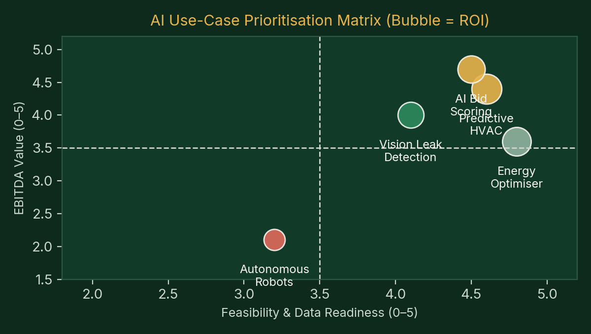
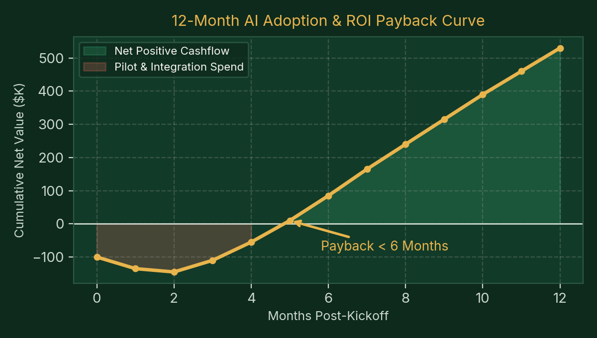
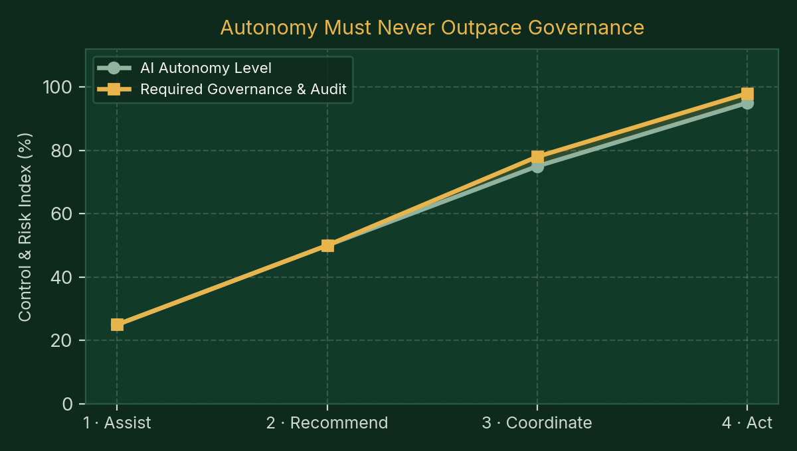
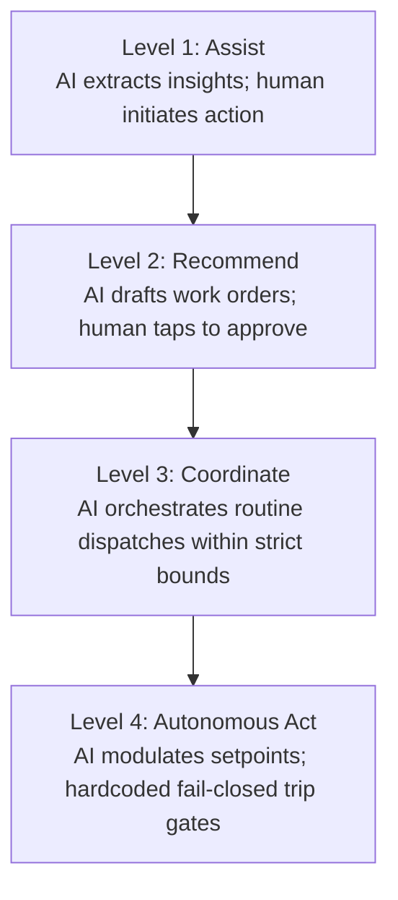

# Chapter 5: Governance, Architecture & Boardroom Intelligence

As artificial intelligence moves from isolated plant-room experiments into mission-critical facilities infrastructure, governance, cybersecurity, and architectural ownership must take center stage. An un-governed AI system that shuts down a hospital HVAC unit or misallocates municipal water resources is a catastrophic corporate liability.

This chapter outlines the **enterprise architectural principles and governance guardrails** designed by AZ Consultants to ensure scalable, compliant, and auditable AI adoption.

---

## 5.1 Boardroom Intelligence: 6 Lenses from Plant Room to P&L

In high-performing FM organizations, reporting has fundamentally evolved:

$$\text{What Happened (Descriptive)} \longrightarrow \text{Why It Happened (Diagnostic)} \longrightarrow \text{What Will Happen (Predictive)} \longrightarrow \text{What Should We Do? (Prescriptive)}$$

The modern C-suite boardroom views enterprise facility operations across six integrated strategic lenses:

| Strategic Boardroom Lens | Primary Operational Focus | Executive P&L Metric |
| :--- | :--- | :--- |
| **1. Growth & Win Probability** | Pre-contract RFP pipeline scoring, tender margin qualification | Qualified pipeline win rate, commercial gross margin |
| **2. Operational Cost-to-Serve** | Cross-departmental workflow friction, technician wrench-time | Direct labor cost per m², administrative overhead index |
| **3. Asset Health & Capital Lifecycle** | Critical MEP asset depreciation, vibration health, RUL modeling | Capex deferral index, extended asset lifespan (+3–5 yrs) |
| **4. Operational Risk & Resilience** | Single-point asset failure exposure, cybersecurity posture, HSEQ | Zero unplanned outage hours, zero lost-time injuries (LTI) |
| **5. ESG & Carbon Decarbonization** | Dynamic energy management, water recycling, refrigerant leak index | kWh/m² intensity, Scope 1 & 2 carbon abatement |
| **6. Cash Flow & Working Capital** | Automated invoice settlement velocity, SLA deduction defense | Days Sales Outstanding (DSO), working capital cycle time |

---

## 5.2 Ecosystem AI: Linking Owners, Tenants, OEMs & Regulators

Facilities management does not operate in a vacuum. Maximum enterprise value is unlocked when data flows seamlessly across the broader property ecosystem:

1. **Asset Owners & Investors**: Access live executive dashboards demonstrating portfolio asset valuation preservation, ESG compliance scores, and audited operational expenditure.
2. **Tenants & Occupants**: Interact with intuitive workplace experience applications offering instant climate adjustment requests, indoor air quality transparency, and automated desk booking.
3. **Suppliers & Original Equipment Manufacturers (OEMs)**: Receive automated machine telemetry forecasts, streamlining warranty validation, predictive spare parts delivery, and factory overhaul scheduling.
4. **Regulators & Municipal Authorities**: Access tamper-proof digital compliance logs for statutory fire/life safety systems, water hygiene (Legionella), and civil defense certifications.

---

## 5.3 The Use-Case Prioritization Matrix: Eliminating Vanity AI

One of the primary reasons FM AI initiatives fail is that organizations waste time and capital on low-impact, high-complexity "vanity projects" (such as autonomous cleaning robots in low-traffic lobbies or complex 3D digital twins with no underlying operational integrations).

AZ Consultants enforces a rigorous **0-to-5 scoring framework across five commercial dimensions** before a single line of code is deployed:

- **EBITDA Impact**: Does this initiative directly expand margin or protect revenue?
- **Data Readiness**: Is clean CAFM/BMS telemetry readily accessible via open protocols?
- **Implementation Velocity**: Can an MVP be field-deployed and verified within 90 days?
- **Operational Risk**: What is the worst-case failure mode if the model outputs an anomaly?
- **Frontline Adoption Feasibility**: Will technicians and supervisors embrace or resist the workflow?

> [!IMPORTANT]
> **The Non-Negotiable Portfolio Rule:**  
> **Kill any AI pilot that lacks a named P&L business sponsor and a clear 90-day quantified KPI.** Fund the top-right Quick-Win Quadrant (*Predictive Chillers, AI Bid Scoring, Vision Leak Detection*) to generate self-funding capital for subsequent operational waves.

---

## 5.4 Disciplined Adoption & The 6-Month Payback Curve

Real digital transformation is 20% technology and 80% change management. When implemented correctly, AI investments follow an aggressive, self-funding J-curve:

- **Months 1–3 (90-Day MVP)**: Test in a single live facility with baseline KPIs and frontline technician involvement. Total net investment remains minimal.
- **Months 4–6 (Workflow Deepening)**: Embed directly into existing CAFM and BMS interfaces—**never create a separate third-party login**. Cumulative cash flow crosses breakeven (**Full Payback in < 6 Months**).
- **Months 7–12 (Portfolio Scaling)**: Reinvest proven net savings ($530K+ annual run-rate per asset cluster) to scale across the broader national portfolio.

---

## 5.5 Scaling Governance: The 4 Autonomy Levels

As autonomous systems scale, governance must scale with equal discipline. Control intensity must match the inherent operational risk of each action:

### The 9 Core Guardrails of Governed AI:
1. **Named Human Accountability**: Every AI pipeline must have a named operational owner (P&L sponsor) and a designated technical guardian.
2. **Zero Vendor Lock-in**: Build on open, modular, model-agnostic data architectures using standard REST/MQTT/BACnet protocols.
3. **100% Client Data Ownership**: Telemetry and operational models remain the sole intellectual property of the asset owner.
4. **Air-Gapped Safety Interlocks**: High-risk plant machinery must maintain mechanical and electrical physical interlocks that prevent software overrides.
5. **Continuous Prompt & Model Drift Monitoring**: Machine learning accuracy must be continuously audited against baseline ground truth.
6. **Least-Privilege Security Scoping**: Edge inference containers possess zero read/write access to corporate financial keyrings.
7. **Complete Audit Traceability**: Every autonomous recommendation and human approval is immutably logged for regulatory review.
8. **Fail-Closed Fallback Architecture**: If network connectivity or model inference drops, systems instantly revert to deterministic BMS schedules.
9. **Zero-Token Local Execution**: Enforce local rule verification before dispatching external LLM API tokens.

---

### Key Takeaways for FM Leadership

- **Govern by Design**: Never allow autonomous execution to outpace your operational control mechanisms.
- **Demand Open Standards**: Never buy a proprietary "black-box" AI system that locks your facility data into a closed vendor ecosystem.
- **Empower Your Frontline**: Tie supervisor and technician incentives directly to digital adoption and avoided asset downtime.

👉 **Next Step:** [Chapter 6: AZ Consultants KSA Funnel & How to Hire Us](06-az-consultants-funnel.md)
