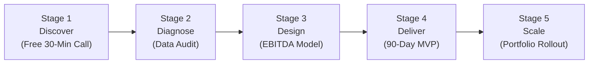

# Chapter 6: The AZ Consultants KSA Engagement Funnel & Hire Us

Moving from strategic aspiration to measurable EBITDA margin expansion requires a trusted, forward-deployed engineering partner who bridges the gap between frontier AI algorithms and muddy plant-room reality.

**AZ Consultants KSA** partners with Asset Owners, Facility Management Executives, and Master Developers across the Kingdom of Saudi Arabia and the GCC to architect, deploy, and monetize intelligent facilities operations.

---

## 6.1 The 5-Stage Path From Idea to EBITDA

We eliminate the risk of speculative technology investments through a structured, stage-gated delivery methodology. **You commit to deeper operational stages only after measurable commercial ROI is proven at each milestone**:

---

### Stage 1: Discover (Complimentary Executive Session)
- **Format**: Free 30-Minute AI-in-FM Readiness Audit with Principal Consultant.
- **Focus**: Map your current portfolio asset profile, contract types, and primary margin pain points.
- **Deliverable**: Walk away with **Three Ranked, High-Yield AI Use Cases** tailored specifically to your asset mix, accompanied by an initial EBITDA opportunity estimate.

### Stage 2: Diagnose (Operational & Data Maturity Audit)
- **Scope**: Comprehensive field and software architectural inspection across active facilities.
- **Activities**: Evaluate CAFM data hygiene, BMS telemetry export capabilities, ERP inventory synchronization, and network edge connectivity.
- **Deliverable**: Full **Data & Process Maturity Scorecard** (0-to-5 scoring across feasibility, risk, and financial return).

### Stage 3: Design (Commercial Roadmap & Governance Blueprints)
- **Scope**: Engineering the financial model, system integration architecture, and operating guardrails.
- **Activities**: Detail the +630 bps EBITDA expansion model, shared-savings contract templates, and human-in-the-loop approval gates.
- **Deliverable**: An investment-grade **Boardroom Transformation Roadmap** with an auditable **sub-6-month capital payback plan**.

### Stage 4: Deliver (90-Day Production MVP & Frontline Adoption)
- **Scope**: Live field deployment in one reference facility or contract cluster.
- **Activities**: Connect live telemetry, deploy mobile copilot tablets to technicians, automate work order dispatches, and establish real-time baseline tracking.
- **Deliverable**: **Verified 90-Day ROI Proof** demonstrating reduced downtime, energy curtailment, and positive frontline adoption metrics.

### Stage 5: Scale (Portfolio-Wide Expansion & Value Realization)
- **Scope**: Enterprise roll-out across all regional, national, and giga-project assets.
- **Activities**: Standardize cross-site data pipelines, integrate executive boardroom dashboards, and conduct quarterly margin expansion audits.
- **Deliverable**: Sustained **15% to 17%+ Net Contract EBITDA** and institutional knowledge retention.

---

## 6.2 Why Industry Leaders Hire AZ Consultants

Traditional management consultants deliver 150-page theoretical PowerPoint presentations that gather dust on executive shelves. Generic software vendors sell proprietary "black-box" platforms that create expensive vendor lock-in.

| Dimension | Generic Management Consultants | Proprietary Software Vendors | AZ Consultants KSA |
| :--- | :--- | :--- | :--- |
| **Operational Reality** | Pure theoretical strategy | Feature-heavy software sales | **Forward-deployed engineers in your plant rooms** |
| **Deliverables** | Static PDF decks | Expensive software licenses | **Working governance, open data architecture & production code** |
| **Commercial Alignment** | Hourly billing regardless of outcome | Annual recurring SaaS subscription | **Tied directly to contract EBITDA expansion & payback** |
| **Regional Grounding** | Generic Western case studies | Disconnected offshore support | **Grounded in Saudi Vision 2030, local labor & climate realities** |

---

## 6.3 Take Action: Book Your Free 30-Minute Readiness Audit

Turn your operational facility data into boardroom decisions and superior contract margins. In this 30-minute strategic consultation with our Principal Engineering Consultant, you will receive:

1. **Three Ranked High-ROI Use Cases** tailored to your facility portfolio (Commercial, Healthcare, Retail, or Giga-Project).
2. **Preliminary EBITDA Margin Waterfall Analysis** identifying where your operations are leaking margin to silos and emergency call-outs.
3. **Architectural Assessment** of your current CAFM, BMS, and ERP integration readiness.

---

### Direct Executive Engagement Channels

- 🌐 **Online Consultation Portal:** [azconsultants-ksa.pages.dev](https://azconsultants-ksa.pages.dev)
- 💬 **Direct WhatsApp (Immediate Response):** [+966 57 426 8856](https://wa.me/966574268856)
- 💼 **LinkedIn Executive Network:** [Aamir Zameer · AZ Consultants KSA](https://www.linkedin.com/in/aamirzameer)
- 📥 **Download the 27-Page C-Suite Deck:** [AZ_AI_in_FM_Value_Chain_A4.pdf](https://github.com/Amz34/fm-ai-value-chain/raw/main/AZ_AI_in_FM_Value_Chain_A4.pdf)
- 💻 **Open-Source Repository & Code:** [github.com/Amz34/fm-ai-value-chain](https://github.com/Amz34/fm-ai-value-chain)

---

> [!NOTE]
> *"AI in Facilities Management is a business transformation enabled by technology and owned by people. Start small with clean data, prove measurable ROI within 90 days, and scale with open, uncompromised governance."*  
> **— Aamir Zameer, Principal Consultant · AZ Consultants KSA**
