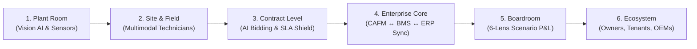

# From the Plant Room to the Boardroom: AI Across the FM Value Chain

**A C-Suite Commercial Playbook & MEED-Grade Whitepaper for Global & KSA FM Leaders**  
*Engineered by **AZ Consultants KSA** (Senior Forward Deployed Engineering & FM Advisory)*  
*Al-Kharj & Riyadh, Kingdom of Saudi Arabia · Built for CEOs, COOs, Asset Owners & FM Executives*

---

> **The Non-Negotiable FM Thesis:**  
> *"80% of AI pilots in Facilities Management fail—not because of inadequate AI models, but because nobody fixed the CAFM-to-BMS-to-ERP data plumbing first. When AI is engineered around P&L outcomes rather than software hype, contract EBITDA expands from 9.0% to 15.3%+ and achieves payback in under 6 months."*

---

## Executive Summary & Verified Benchmarks

Facilities Management under **ISO 41001** and **IFMA** standards integrates *People, Place, and Process* to protect core enterprise operations. Across the Kingdom of Saudi Arabia and the GCC, the transition of Vision 2030 giga-projects (NEOM, Red Sea Global, Qiddiya, ROSHN, Diriyah Gate) from construction phase into 20-year operational lifecycle demands a fundamental pivot from commodity headcounts to intelligent, AI-orchestrated facility operations.

| Executive Metric | Verified Industry Benchmark | Strategic & Commercial Impact |
| :--- | :--- | :--- |
| **KSA FM Market Expansion** | **$37.7B → $67.5B** (2025–2030E, 12.4% CAGR) | Rapid shift from CAPEX build to multi-decade IFM operational contracts |
| **Unplanned Equipment Downtime** | **50% – 70% Reduction** | Eliminates emergency reactive call-outs, tenant churn, and SLA penalty deductions |
| **Preventive Maintenance Cost** | **10% – 40% Direct Savings** | Dynamic condition-based intervention replaces arbitrary calendar-based PPM schedules |
| **Commercial Energy Waste** | **~30% Addressable Waste Eliminated** | Continuous AI HVAC and chiller plant optimization directly expands gross margin |
| **Contract Net EBITDA Margin** | **9.0% → 15.3%+** (+630 bps Expansion) | High-margin compounding through energy recapture, automated routing, and SLA protection |
| **Typical Capital Payback Horizon** | **< 6 Months** | Self-funding operational transformation without massive rip-and-replace CAPEX |

---

## The 6-Layer Connected FM Journey

Rather than deploying disconnected AI point solutions that create new operational silos, the **AZ Consultants Connected FM Framework** unifies the facility stack from physical assets to institutional governance:

---

## Comprehensive Chapter Guide

=== "1. Market Outlook & Pain Points"
    Explore the macro forces driving the KSA FM market to **$67.5B by 2030**, why 78% of FM leaders lose margin to legacy silos, and how the 5 FM maturity stages triple EBITDA margins from 5% commodity contracts to 17%+ intelligent IFM.  
    👉 [Read Chapter 1: Market Outlook & Pain Points](01-market-and-pain-points.md)

=== "2. The AI Toolbox for FM"
    Deconstruct the six specialized AI capabilities: Vision AI for 24/7 CCTV leak detection, Agentic AI cross-system orchestration (BMS, CAFM, ERP), Predictive ML, GenAI proposal automation, and human-in-the-loop approval gates.  
    👉 [Read Chapter 2: The AI Toolbox for FM](02-ai-toolbox.md)

=== "3. KSA & GCC Case Studies"
    Examine three verified field audits:
    - **KSA Healthcare Chiller**: 62% downtime reduction and SAR 180K penalty avoidance.
    - **Riyadh Commercial Portfolio**: Mobilisation compressed from 90 to 35 days.
    - **Closed-Loop Institutional Memory**: Contract renewal rate boosted from 54% to 86%.  
    👉 [Read Chapter 3: KSA & GCC Case Studies](03-ksa-case-studies.md)

=== "4. Commercial & EBITDA Playbook"
    Unpack the verified **+630 bps EBITDA Waterfall**: Energy AI (+2.4%), Labour routing (+2.1%), Avoided fines (+1.8%), 50/50 shared-savings contracts, and reducing cost-to-serve by 36 index points.  
    👉 [Read Chapter 4: Commercial & EBITDA Playbook](04-ebitda-playbook.md)

=== "5. Governance & Architecture"
    Discover how to scale AI without vendor lock-in using an open, modular data spine, the 4-stage autonomy governance ladder (*Assist → Recommend → Coordinate → Act*), and the Boardroom 6-lens scenario dashboard.  
    👉 [Read Chapter 5: Governance & Architecture](05-governance-and-architecture.md)

=== "6. AZ Consultants KSA Funnel & Hire Us"
    Engage AZ Consultants through our structured 5-stage transformation pathway: *Discover → Diagnose → Design → Deliver → Scale*. Book a complimentary 30-minute AI readiness audit and receive 3 ranked use cases.  
    👉 [Read Chapter 6: AZ Consultants Engagement Funnel](06-az-consultants-funnel.md)

---

## Executive Engagement & Whitepaper Downloads

- **Official 27-Page C-Suite Deck (PDF):** [Download AZ_AI_in_FM_Value_Chain_A4.pdf](https://github.com/Amz34/fm-ai-value-chain/raw/main/AZ_AI_in_FM_Value_Chain_A4.pdf)
- **Book Strategic Advisory:** [AZ Consultants KSA Portal — https://azconsultants-ksa.pages.dev](https://azconsultants-ksa.pages.dev)
- **LinkedIn Newsletter (TIME TO ELEVATE FM):** [Read & Subscribe: AI Across the FM Value Chain](https://lnkd.in/eDBfX4TS)
- **Direct WhatsApp Consultation:** [Chat with Principal Consultant (+966 57 426 8856)](https://wa.me/966574268856)
- **LinkedIn Executive Network:** [Aamir Zameer (AZ Consultants)](https://www.linkedin.com/in/aamirzameer)

---

## Live LinkedIn Briefing & Newsletter

  <iframe src="https://www.linkedin.com/embed/feed/update/urn:li:share:7529053374915366914" height="1635" width="100%" frameborder="0" allowfullscreen="" title="Embedded post"></iframe>

